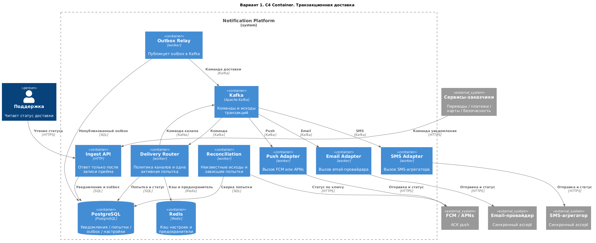
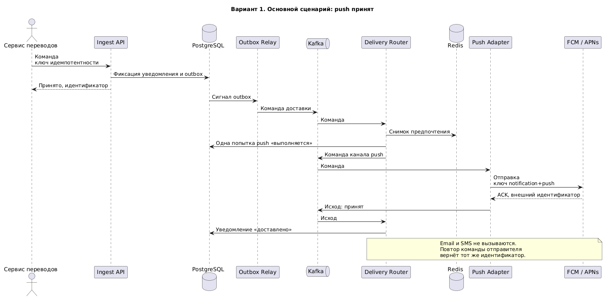
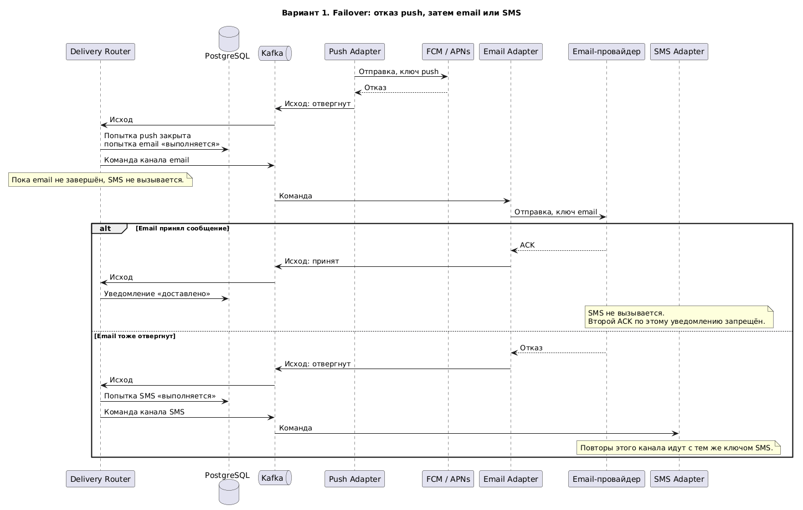
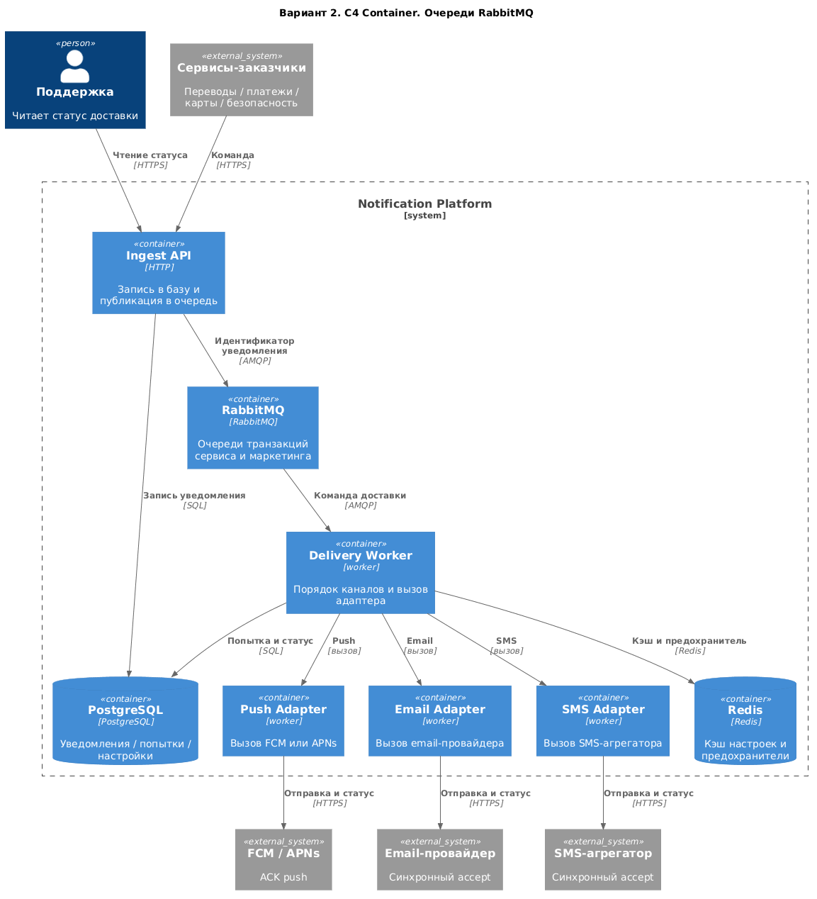
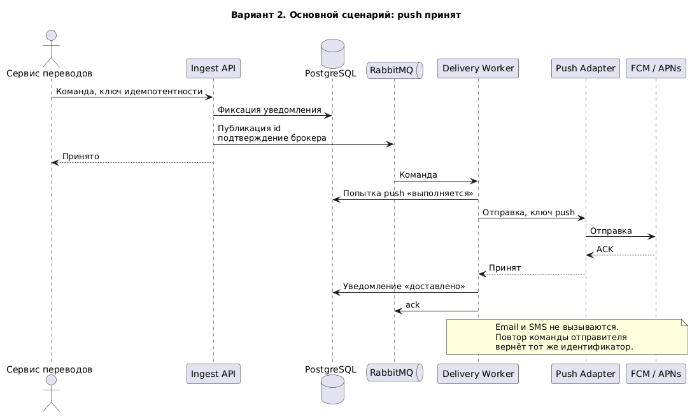
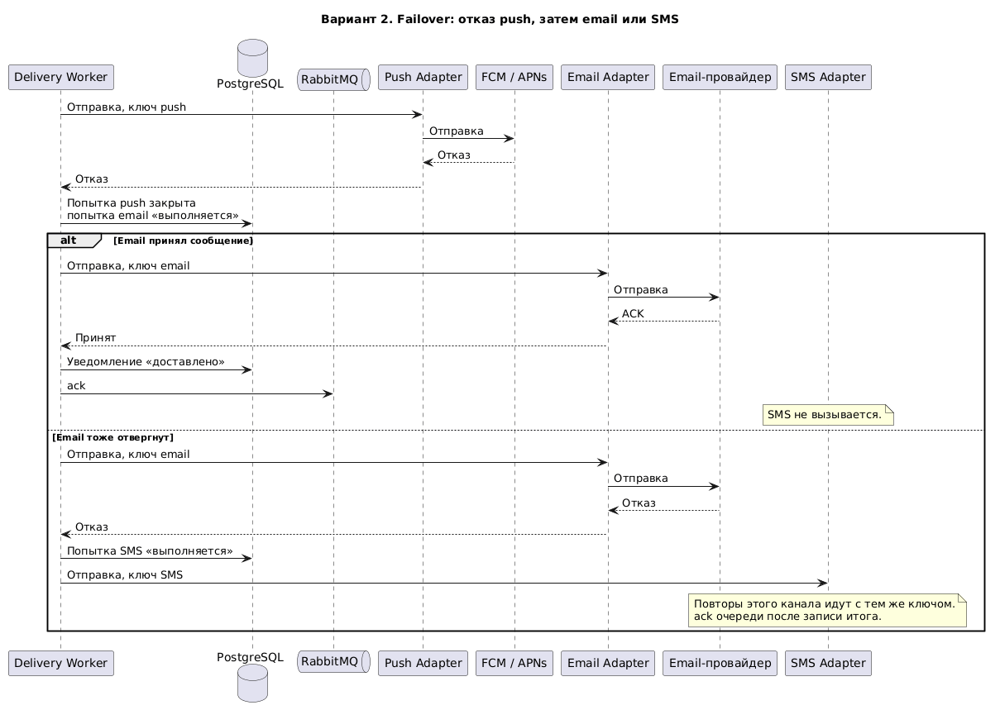

# RFC: Гарантированная доставка критичных уведомлений с кросс-канальным failover

| Метаданные | Значение |
| --- | --- |
| **Статус** | DRAFT |
| **Автор(ы)** | Наседкин Дмитрий |
| **Ответственный** | Наседкин Дмитрий |
| **Бизнес-заказчик** | Сервис переводов; сервис платежей и списаний; сервис карт; сервис безопасности и аутентификации |
| **Ревьюеры** | не назначены |
| **Дата создания** | 2026-11-17 |
| **Дата обновления** | 2026-11-17 |

Требования всей Notification Platform и идентификаторы FR, NFR, ASR зафиксированы в [requirements.md](requirements.md). Этот RFC детализирует их для подсистемы, которая доставляет транзакционные уведомления хотя бы в один канал и переключает канал при отказе.

---

## Оглавление

1. [Контекст](#контекст)
2. [Продуктовый анализ](#продуктовый-анализ)
3. [Пользовательские сценарии](#пользовательские-сценарии)
4. [Статистика](#статистика)
5. [Требования](#требования)
6. [Варианты решения](#варианты-решения)
7. [Сравнительный анализ](#сравнительный-анализ)
8. [Выводы](#выводы)
9. [Связанные задачи](#связанные-задачи)
10. [Приложения](#приложения)

---

## Контекст

Критичное уведомление — транзакционное: подтверждение перевода и списание средств. Недоставка бьёт по доверию и по безопасности. Каналы разные по задержке, цене и надёжности. Push для банка практически бесплатен, SMS стоит на порядки дороже, внешние провайдеры отказывают пачками.

Сейчас команды шлют такие сообщения сами. Платформа забирает у них доставку. Этот RFC проектирует только транзакционный контур с автоматическим failover. Сервисные и маркетинговые сообщения платформа тоже примет, но у них другие пределы, и в этот механизм они не входят.

Успех — ACK провайдера, не прочтение. Пользователь задаёт предпочтительный канал и не может выключить канал. Порядок: предпочтительный, затем оставшиеся из последовательности push → email → SMS. Одно событие — одно сообщение пользователю.

### Ключевые вопросы

- Какую проблему мы решаем? Принятая транзакционная команда не должна теряться молча и не должна превращаться в два или три сообщения, когда первый канал отказал.
- Почему это важно сейчас? Без общего механизма каждая команда снова встроит свой повтор и свой SMS, и цели по жалобам и по гарантии доставки останутся недостижимы.
- Кто затронут? Клиент банка, поддержка, сервисы переводов, платежей, карт и безопасности, дежурные платформы, финансы — через объём SMS.

### Граница RFC

Внутри границы: приём транзакционной команды, снимок настроек, выбор канала, вызов провайдера, failover, защита от дубля, статус для поддержки, метрики SLO.

Снаружи: вёрстка шаблонов, биллинг SMS, интерфейс профиля, планировщик кампаний, failover статуса заявки, второй SMS-вендор на том же канале. Настройки профиль хранит так, как описано ниже, потому что без них маршрутизация не на чем работать. Кампании этот RFC учитывает только как чужую нагрузку, от которой транзакционный контур изолирован (ASR-3).

---

## Продуктовый анализ

Платформа нужна трём сторонам, и подсистема доставки закрывает разные их задачи.

Клиент хочет сразу узнать, что перевод или списание прошли, и получить это один раз, в том канале, который он выбрал. Повтор тем же текстом в SMS через минуту после push выглядит как сбой банка.

Сервис-заказчик хочет отдать событие одной командой и получить ответ, что платформа ответственность взяла. Он не хочет знать, жив ли FCM, и не хочет встраивать запасной SMS.

Поддержка хочет по идентификатору сказать, ушло сообщение или нет и каким каналом. Дежурный хочет увидеть падение доли ACK раньше, чем это станет пачкой обращений.

Финансовая сторона хочет, чтобы SMS оставался редким шагом. Прямой метрикой RFC это не является: тариф в задании не задан. Прямые метрики подсистемы — NFR-1, NFR-2, NFR-3, NFR-7.

Цели банка G1 (+15% удержания) и G2 (−30% жалоб) эта подсистема сама по себе не принимает как сдаточный тест. Она убирает два известных источника жалоб и недоверия: опоздание критичного сообщения и дубль. Вклад в G1 и G2 проверяется продуктовыми замерами после пилота, не критерием приёмки RFC.

Политика классов, уже зафиксированная для всей платформы. Классов три:

- транзакционные отключить нельзя;
- сервисные (напоминания и статус заявки — один класс) отключить можно, только целиком;
- маркетинговые отключить можно, только целиком;
- канального выключателя нет.

На транзакционном пути проверяется только снимок предпочтительного канала и техническая доступность адреса. Флаги маркетинга на этот класс не действуют.

---

## Пользовательские сценарии

| Приоритет | Тип сценария | Действующее лицо | Сценарий |
| --- | --- | --- | --- |
| MUST HAVE | Доставка | Пользователь | После перевода получает одно сообщение. Первым пробуется предпочтительный канал. |
| MUST HAVE | Приём | Сервис переводов | Передаёт команду и получает подтверждение приёма. Повтор с тем же ключом не создаёт второе уведомление. |
| MUST HAVE | Failover | Платформа | Push отвергнут. Следующий доступный канал — email. SMS не начинается, пока email не завершился неуспехом. Пользователь получает одно сообщение. |
| MUST HAVE | Предпочтение SMS | Пользователь | Предпочтительный канал — SMS. Первая попытка — SMS. При отказе SMS дальше идут push и email. |
| MUST HAVE | Нет адреса | Платформа | Push-токена нет. Канал пропускается как недоступный, это не отказ пользователя от push. Доставка идёт со следующего канала. |
| MUST HAVE | Все каналы отвергли | Платформа | Запись остаётся, дежурный видит окончательный неуспех, повтор возможен. Команда не удаляется. |
| SHOULD HAVE | Потерянный ответ | Платформа | Ответ провайдера не вернулся. Повтор идёт в тот же канал с тем же ключом. Другой канал не начинается, пока нет явного отказа или подтверждённой недоступности провайдера. |
| SHOULD HAVE | Поддержка | Сотрудник поддержки | По идентификатору видит статус, каналы, исходы попыток и идентификатор у провайдера. |
| COULD HAVE | Второй поставщик SMS | Платформа | При отказе агрегатора пробует второго поставщика SMS, не меняя канал. В первой версии канал SMS — один агрегатор. |

---

## Статистика

Исходные данные задания и согласованный пиковый коэффициент 10×.

| Показатель | Значение |
| --- | --- |
| MAU | 10 млн |
| DAU | 3 млн |
| Пик одновременных пользователей | 300 тыс. |
| Транзакционных на пользователя в день | 2 |
| Сервисных | 3 |
| Маркетинговых | 5 |
| Кампания | до 1 млн получателей за 60 минут |

Рабочая база — DAU (допущение U1 в требованиях). В сутках 86 400 секунд.

| Класс | В сутки | Средний поток | Пик ×10 |
| --- | ---: | ---: | ---: |
| Транзакционные | 6,0 млн | 69,4 сообщ/с | 694 сообщ/с |
| Сервисные | 9,0 млн | 104,2 сообщ/с | 1 042 сообщ/с |
| Маркетинговые | 15,0 млн | 173,6 сообщ/с | 1 736 сообщ/с |
| Всего | 30,0 млн | 347,2 сообщ/с | 3 472 сообщ/с |

Альтернатива MAU только для транзакций: 20 млн в сутки, 231 сообщ/с в среднем, пик около 2 315 сообщ/с.

Кампания 1 млн за час при ровной отправке — около 278 сообщ/с. Её исполнители не общие с транзакциями.

Горячий набор настроек — одновременные пользователи, 300 тыс. Запись предпочтения компактная, рабочий набор кэша укладывается в сотни мегабайт. Это не узкое место.

Журнал транзакционной доставки на рабочей базе: порядка 10 ГБ в сутки вместе с индексами при оценке около 1 КБ на уведомление с попытками, порядка 1 ТБ за 90 суток хранения. Оценка размера строки — допущение, не замер.

Запись на пике рабочей базы. На одно уведомление приходится до четырёх коротких фиксаций: приём с исходящей записью, отметка публикации, старт попытки, терминальный исход. 694 × 4 ≈ 2,8×10³ фиксаций/с. На трактовке MAU — около 10⁴ фиксаций/с.

Поток в брокер на пике всех классов при оценке 2 КБ на сообщение — около 7 МБ/с. Транзакционный пик — около 1–2 МБ/с. Для брокера это небольшой поток. Узкое место не в сети брокера, а в фиксациях состояния и в задержке внешних провайдеров.

Одновременные вызовы push на пике 694 сообщ/с при задержке провайдера 300 мс — около 2×10² запросов в полёте. Задержка 300 мс — ориентир для расчёта ёмкости, не SLA провайдера. Адаптеры поэтому горизонтально расширяются, но на рабочей базе речь об единицах экземпляров на канал.

Бюджет ошибки NFR-2: 0,1% от 6 млн — до 6 000 транзакционных уведомлений в сутки вне окна 5 минут. Каждое такое уведомление остаётся в журнале. Порог 99,9% — сигнал по доле, не план потерь.

Стоимость SMS в архитектуру входит порядком, не тарифом. При иллюстративных 2 ₽ за SMS и 6 млн транзакций в сутки: 1% потока — 120 тыс. ₽/сутки, 15% — 1,8 млн ₽/сутки. Отсюда запрет веера и отложенное включение SMS-failover до замера покрытия push (U2).

---

## Требования

Требования подсистемы уточняют FR-1…FR-7 и NFR-1…NFR-8 для транзакционного контура. Приоритеты ASR те же: ASR-1, ASR-2, ASR-3 — P0; ASR-4 и ASR-5 — P1.

### Функциональные требования

| № | Приоритет | Обозначение | Требование |
| --- | --- | --- | --- |
| 1 | MUST HAVE | FR-D1 | Сервис-заказчик передаёт транзакционную команду с ключом идемпотентности. Повтор ключа возвращает ту же запись. Успешный ответ о приёме означает, что запись уже сохранена. |
| 2 | MUST HAVE | FR-D2 | После приёма платформа сама доводит уведомление до ACK одного канала или до явного окончательного неуспеха. Отправитель failover не вызывает. |
| 3 | MUST HAVE | FR-D3 | Канал выбирается по снимку предпочтения и порядку push → email → SMS. В полёте одна попытка. Следующий канал начинается после неуспеха предыдущего. |
| 4 | MUST HAVE | FR-D4 | Веерной отправки нет. Второй ACK по тому же уведомлению — дефект. |
| 5 | MUST HAVE | FR-D5 | Потерянный ответ провайдера повторяется в тот же канал с тем же ключом. Канал меняется после явного отказа, после подтверждённой недоступности провайдера или после статуса «сообщение не принято». |
| 6 | MUST HAVE | FR-D6 | Нет токена, телефона или адреса — канал пропускается. Это не пользовательский отказ от канала и не терминальный провал всего уведомления. |
| 7 | MUST HAVE | FR-D7 | Если все доступные каналы отвергли сообщение, запись переходит в явный неуспех и остаётся доступна поддержке. Всплеск таких статусов поднимает сигнал дежурным. Повтор цепочки возможен. |
| 8 | MUST HAVE | FR-D8 | Поддержка читает статус, список попыток, канал успеха и внешний идентификатор провайдера. |
| 9 | SHOULD HAVE | FR-D9 | Цепочка каналов повторяется по расписанию, пока не исчерпан предел повторов, если ни одного ACK не было. Повтор использует прежние ключи каналов. |

Правило FR-D5 — ответ на AQ-4. Оно сознательно ставит запрет дубля выше мгновенного прыжка на SMS. Окно NFR-2 при этом сохраняется: явный отказ и открытый предохранитель канала переключают канал сразу, ожидание относится только к неизвестному исходу живого провайдера.

Стартовые пределы повторов, их можно менять по результатам U3:

- до 2 повторов вызова одного канала с тем же ключом при обрыве ответа;
- одна проверка статуса, если провайдер её даёт;
- если провайдер признан недоступным, канал завершается неуспехом без дальнейших пауз и берётся следующий;
- если ACK нет ни по одному каналу, вся цепочка повторяется не чаще раза в минуту и не дольше 15 минут, затем ставится статус окончательного неуспеха. Дежурные получают сигнал по всплеску таких статусов, а не по каждому сообщению отдельно: на пике отдельный вызов на каждое сообщение создал бы сотни тысяч сигналов.

Пятнадцать минут шире окна SLO в 5 минут. Сообщения, успевшие после пятой минуты, попадают в бюджет ошибки 0,1% по времени и при этом не теряются молча.

### Нефункциональные требования

| № | Приоритет | Обозначение | Требование |
| --- | --- | --- | --- |
| 1 | MUST HAVE | NFR-1 | p99 старта первой попытки ≤ 2 с. |
| 2 | MUST HAVE | NFR-2 | p99 первого ACK ≤ 30 с; ≥ 99,9% транзакционных имеют ACK в пределах 5 минут за месяц. |
| 3 | MUST HAVE | NFR-3 | Доля дублей сообщения < 0,1% за месяц. |
| 4 | MUST HAVE | NFR-4 | Пик около 694 транзакционных сообщ/с и кампания 1 млн за час не выводят транзакции из NFR-1 и NFR-2. |
| 5 | MUST HAVE | NFR-5 | Приём доступен ≥ 99,9% за месяц. Ответ об успешном приёме не выдаётся без записи. |
| 6 | MUST HAVE | NFR-6 | Статус виден поддержке не позднее 1 минуты после смены. Сигнал дежурным — если на часовом окне доля ACK за 5 минут ниже 99,9% или если растёт всплеск окончательных неуспехов. |
| 7 | MUST HAVE | NFR-7 | Доля веерных отправок = 0. Доля SMS объясняется политикой, а не параллельным запуском. |
| 8 | MUST HAVE | NFR-8 | Новые команды видят смену предпочтения не позднее 60 с. Идущая доставка снимок не меняет. |

Разложение бюджета NFR-1, чтобы путь можно было проверять по частям:

| Участок | Вклад в p99 |
| --- | ---: |
| Приём и фиксация записи | ≤ 200 мс |
| Публикация команды во внутренний брокер | ≤ 300 мс |
| Выбор канала и фиксация попытки | ≤ 200 мс |
| Ожидание свободного адаптера | остаток до 2 с |

Вызов провайдера в эти 2 с не входит. Он входит в 30 с до первого ACK.

**Расчёт нагрузок:**

```
База DAU = 3 000 000
Транзакционные в сутки = 3 000 000 × 2 = 6 000 000
Средний поток = 6 000 000 / 86 400 ≈ 69,4 сообщ/с
Пик ×10 ≈ 694 сообщ/с

Все классы в сутки = 3 000 000 × 10 = 30 000 000
Средний поток ≈ 347 сообщ/с, пик ×10 ≈ 3 472 сообщ/с
Кампания = 1 000 000 / 3 600 ≈ 278 сообщ/с

Фиксации состояния на транзакционном пике ≈ 694 × 4 ≈ 2,8×10³ / с
Альтернатива MAU: 10 000 000 × 2 / 86 400 ≈ 231 сообщ/с, пик ≈ 2 315 сообщ/с,
фиксации ≈ 10⁴ / с

Журнал: порядок 10 ГБ/сутки, порядок 1 ТБ на 90 суток
Брокер: транзакционный пик 1–2 МБ/с, все классы на пике около 7 МБ/с
Push в полёте: 694 × 0,3 с ≈ 2×10²
Бюджет 0,1%: до 6 000 сообщений/сутки вне окна 5 минут
```

Ориентир ёмкости одного первичного PostgreSQL для этого профиля — порядка 5×10³ коротких фиксаций/с. Это не бенчмарк банка, а порог, после которого рабочая схема «один primary» пересматривается. Рабочий пик 2,8×10³ ниже порога. Пик трактовки MAU — выше. Поэтому ключ разделения данных закладывается сразу, физически второй шард появляется после сверки U1 и прогона записи.

### Правило неизвестного исхода

1. Адаптер вызывает провайдера с ключом `notification_id + channel`.
2. Явный отказ или открытый предохранитель канала закрывает попытку неуспехом, маршрутизатор берёт следующий канал.
3. Обрыв ответа: до двух повторов с тем же ключом.
4. Если ответа всё ещё нет и у провайдера есть чтение статуса — читается статус.
5. Статус «принят» закрывает уведомление успехом, даже если первый ответ потерялся.
6. Статус «нет такого сообщения» или подтверждённая недоступность провайдера переключает канал.
7. Пока статус неизвестен и провайдер не признан недоступным, следующий канал не стартует.

Предохранитель канала — настраиваемый. Стартовая пауза пропуска канала 30 с, чтобы больной провайдер не съедал окно ACK ожиданием. Отказ Redis предохранителем канала не является: при недоступности Redis предпочтение читается из PostgreSQL, канал не пропускается. Иначе сбой кэша массово откроет SMS.

### Соответствие ASR

| ASR | Что обязана сделать подсистема |
| --- | --- |
| ASR-1 P0 | Запись до ответа отправителю, одна активная попытка, идемпотентность, отдельное правило потерянного ответа, явный остаток без ACK. |
| ASR-2 P0 | Короткий приём, бюджеты участков, пропуск заведомо больного канала, кампания вне пути. |
| ASR-3 P0 | Отдельные очереди брокера, отдельные исполнители и отдельная деградация транзакций. |
| ASR-4 P1 | Одна политика порядка, снимок предпочтения, SMS не параллелится. |
| ASR-5 P1 | Сквозной идентификатор, журнал попыток, метрики, сигнал по 99,9% и по окончательному неуспеху. |

---

## Варианты решения

Оба варианта исполняют одну и ту же политику FR-D1…FR-D9. В варианте 1 очередь — Kafka, команда попадает туда отдельным процессом из базы. В варианте 2 очередь — RabbitMQ, API кладёт команду в неё сам.

Общие технологии и масштаб, одинаковые для обоих:

- PostgreSQL — источник правды по уведомлению, попытке, настройке и идемпотентности приёма.
- Redis — кэш снимка настроек и состояние предохранителей. Не источник правды.
- Push: FCM и APNs, у уведомления один токен и один из этих провайдеров.
- Email: внешний провайдер с синхронным accept. Пример класса интеграции — корпоративный ESP. Конкретный вендор не зафиксирован.
- SMS: один агрегатор с синхронным accept. Пример класса — агрегатор уровня SMS-центра. Второй вендор в первой версии не подключается.
- Наблюдаемость: метрики Prometheus, дашборды Grafana, трассы OpenTelemetry, структурированные логи без секретов и без полных реквизитов.
- Масштаб проектирования — рабочая база DAU и пик 694 транзакционных сообщ/с, с порогом пересмотра из раздела нагрузок.

Язык сервисов не фиксируется. Контракты ниже не зависят от него.

Модель данных, общая для вариантов:

- Уведомление: идентификатор, ключ идемпотентности отправителя, сервис-источник, пользователь, класс, шаблон, ссылка на параметры, снимок предпочтения, статус, времена.
- Попытка: уведомление, канал, номер, ключ провайдера, статус, внешний идентификатор, ошибка, времена.
- Ограничение: одна попытка в статусе «выполняется» на уведомление.
- Ограничение: один ключ идемпотентности на сервис-источник.

Статусы уведомления: принято, доставляется, доставлено, ждёт повтор цепочки, окончательный неуспех, отвергнуто как некорректная команда.

Параметры шаблона с одноразовыми кодами в журнал попыток в открытом виде не пишутся. В трассу попадает идентификатор шаблона и канал, не секрет.

### Вариант 1: Маршрутизатор и журнал попыток

> **Описание:** Состояние failover хранится в PostgreSQL. Отдельный маршрутизатор по журналу попыток решает, какой канал следующий. Kafka развязывает приём, маршрутизатор и адаптеры. Оркестратора процессов нет.

#### Архитектура

Граница сервисов. Сервисы переводов, платежей, карт и безопасности не вызывают FCM, почту и SMS и не читают базу платформы. Их контракт — команда приёма. Адаптеры каналов — антикоррупционный слой: наружу уходит ключ идемпотентности и тело шаблона, внутрь возвращается ACK, явный отказ или неизвестный исход.

Приём. Ingest API в одной фиксации пишет уведомление и исходящую запись outbox, затем отвечает успехом. Публикация в Kafka из этого запроса не делается: ответ отправителю не зависит от брокера. Релей читает непубликованный outbox, будится сигналом PostgreSQL и дополнительно опрашивает таблицу с коротким интервалом, чтобы сигнал не был единственной гарантией. Цель интервала — вклад релея в p99 не больше 300 мс.

Маршрутизатор читает команду из темы транзакций, блокирует уведомление, прекращает работу, если уже есть ACK или выполняющаяся попытка, пишет попытку и публикует команду канала. Адаптер вызывает провайдера. Исход возвращается в тему исходов. Маршрутизатор либо закрывает уведомление, либо открывает следующую попытку.

Ключ партиции — идентификатор уведомления, поэтому команды одного уведомления обрабатываются по порядку.

Redis на этом пути только ускоряет чтение предпочтения. Источник настройки — PostgreSQL. Инвалидация кэша при сохранении настройки плюс короткий TTL держат NFR-8 в пределах 60 с.

Изоляция ASR-3. Темы и группы потребителей транзакций, сервиса и маркетинга разные. У маркетинга свой пул адаптеров и свой предел скорости. Транзакционный маршрутизатор маркетинговую тему не читает. Приём транзакции зависит от PostgreSQL, не от того, успевает ли кампания.

Предохранитель и сверка неизвестных исходов — отдельные небольшие исполнители. Сверка нужна, если процесс упал после отправки и до записи ACK: попытка остаётся «выполняется», сверка читает статус провайдера или повторяет тот же ключ.

Потоки отказа:

- PostgreSQL недоступен — приём не подтверждается, отправитель повторяет тот же ключ.
- Kafka недоступен — приём подтверждается, outbox стареет, сигнал по возрасту outbox, доставка догоняет после восстановления.
- Redis недоступен — чтение настройки из PostgreSQL, каналы не пропускаются.
- Провайдер недоступен — предохранитель пропускает канал, следующий канал по политике.

#### Диаграмма C4 Container



Пользователь на диаграмме контейнеров не показан: показ на устройстве не является ACK и в контракт платформы не входит. ACK приходит от провайдера в адаптер.

#### Sequence: основной сценарий

Предпочтение — push, FCM принимает сообщение с первого вызова. SMS и email не вызываются.



#### Sequence: failover

Префикс до первой попытки совпадает с основным сценарием. Диаграмма начинается с уже принятой команды и попытки push.



Отдельная ветка потерянного ответа, её исполняет тот же маршрутизатор. Адаптер повторяет тот же ключ. Если провайдер на повторе отвечает «уже принято», попытка закрывается успехом, email не начинается. Сверка подбирает попытку, зависшую после падения процесса.

#### Как вариант закрывает ASR

| ASR | Реализация |
| --- | --- |
| ASR-1 | Запись и outbox в одной фиксации до ответа. Одна активная попытка — ограничение в PostgreSQL. Ключ отправителя и ключ канала. Смена канала только по правилу FR-D5. Окончательный неуспех остаётся строкой. |
| ASR-2 | Отправитель не ждёт провайдера. Участки бюджета разложены. Релей не опрашивает outbox раз в секунды вхолостую: сигнал будит его сразу, опрос страхует потерю сигнала. Больной канал пропускается предохранителем. |
| ASR-3 | Отдельные темы и пулы. Кампания не читается транзакционным маршрутизатором. |
| ASR-4 | Политика в одном маршрутизаторе. Снимок в записи уведомления. Адаптер не выбирает «запасной SMS сам». |
| ASR-5 | Журнал попыток — источник экрана поддержки. Метрики возраста outbox, доли ACK, вторых ACK, доли SMS, неизвестных исходов. Трасса OpenTelemetry от приёма до ACK. |

#### Технологии

Apache Kafka, PostgreSQL, Redis, HTTP-адаптеры к FCM, APNs, email-провайдеру и SMS-агрегатору, Prometheus, Grafana, OpenTelemetry.

Отдельного движка процессов нет. Состояние шага — строка попытки.

#### Масштаб

Вариант рассчитан на пик 694 транзакционных сообщ/с и около 2,8×10³ фиксаций/с в одном primary PostgreSQL с репликой для чтения поддержки. Ключ разделения — идентификатор уведомления: при подтверждении трактовки MAU или при устойчивом превышении ориентира 5×10³ фиксаций/с журнал делится по этому ключу, контракт сервисов не меняется.

Kafka на этом потоке — единицы мегабайт в секунду. Стартово 12 партиций транзакционной темы. Диск брокера на несколько суток хранения — сотни гигабайт с учётом репликации, не единицы терабайт, пока пиковый поток не принимают за круглосуточный.

Ёмкость адаптеров — порядок 10² одновременных HTTP-вызовов на push. Экземпляры адаптеров добавляются по задержке провайдера, не по числу сообщений в брокере.

#### Этапы реализации

Сроки и состав — оценка для сравнения вариантов, не план проекта.

| Этап | Описание | Планируемый срок | Ресурсы | Риски |
| --- | --- | --- | --- | --- |
| 1 | Контракт приёма, модель, идемпотентность, ответ после записи | 2 недели | 2 backend | Ключ идемпотентности с сервисом переводов ещё не согласован |
| 2 | Outbox, релей, маршрутизатор, push, метрики пути | 3 недели | 2 backend, 0,5 SRE | p99 участков не укладывается в 2 с |
| 3 | Email, SMS, предохранитель, сверка неизвестного исхода | 2 недели | 2 backend | У агрегатора нет ключа идемпотентности |
| 4 | Нагрузочный прогон, пилот на сервисе переводов, SMS-failover за флагом | 2 недели | 2 backend, 1 QA, 0,5 SRE | Покрытие push неизвестно |

Оценка целиком: около 9 недель.

#### Преимущества

- Состояние доставки одно: PostgreSQL. Поддержка и маршрутизатор читают одно и то же.
- Путь до первой попытки короткий: приём, outbox, брокер, маршрутизатор, адаптер.
- Отказ Kafka не отменяет уже выданный приём.
- На пике рабочей базы хватает одного primary и небольшого числа экземпляров.
- Политика из трёх последовательных каналов читается по журналу попыток без отдельной платформы оркестрации.

#### Недостатки

- Корректность «одна активная попытка» и правило потерянного ответа — код маршрутизатора и ограничения базы. Ошибка в переходе стоит дубля или зависшей попытки.
- Релей outbox — отдельный процесс, за ним нужен сигнал по возрасту непубликованной записи.
- Длинные будущие ветки (ожидание до утра, эскалация в звонок) в этом автомате станут цепочкой особых случаев.
- Один primary — потолок. Выше ориентира 5×10³ фиксаций/с схему записи надо делить.

---

### Вариант 2: Очереди RabbitMQ

> **Описание:** PostgreSQL хранит уведомление и попытки. После записи API само кладёт команду в очередь RabbitMQ и только потом отвечает отправителю. Воркер забирает команду, обходит каналы и подтверждает сообщение очереди, когда итог записан в базу. Отдельного релея и Kafka нет.

#### Архитектура

Приём. API в одной фиксации пишет уведомление в PostgreSQL. Затем публикует в RabbitMQ идентификатор уведомления и ждёт подтверждения брокера. Успешный ответ отправителю уходит после обоих шагов. Если RabbitMQ не подтвердил публикацию, отправитель получает ошибку и повторяет тот же ключ: вторая запись не создаётся, публикация повторяется.

Если процесс API упал после записи в базу и до публикации, строка остаётся в статусе «принята, в очередь не положена». Короткий обход таких строк публикует их снова. Это не отдельный конвейер outbox, а добор уже сохранённых команд.

Доставка. У транзакций, сервиса и маркетинга разные очереди и разные воркеры. Транзакционный воркер маркетинговую очередь не читает. Сообщение очереди подтверждается (ack) только после записи итога попытки в PostgreSQL. Если воркер умер раньше, RabbitMQ отдаёт команду другому воркеру. Тот сначала читает статус в базе: при уже полученном ACK провайдера повторная отправка не начинается.

Воркер сам выбирает канал по снимку предпочтения и вызывает адаптер. Явный отказ или открытый предохранитель переводит к следующему каналу в том же сообщении очереди. Потерянный ответ повторяется в тот же канал с тем же ключом. Другой канал начинается после явного отказа или когда провайдер признан недоступным.

Очереди кворумные, три узла RabbitMQ: запись команды переживает отказ одного узла. Повторные доставки сверх лимита уходят в очередь ошибок, запись в базе становится окончательным неуспехом.

Redis используется так же, как в варианте 1: кэш предпочтения и предохранитель. При его отказе предпочтение читается из PostgreSQL.

#### Диаграмма C4 Container



#### Sequence: основной сценарий



#### Sequence: failover



Потерянный ответ воркер повторяет в тот же канал с тем же ключом и только потом меняет канал. Сообщение RabbitMQ остаётся неподтверждённым, пока итог не записан в PostgreSQL. Повторная доставка из очереди сверяется со статусом в базе и не шлёт второй канал после ACK.

#### Как вариант закрывает ASR

| ASR | Реализация |
| --- | --- |
| ASR-1 | Запись в PostgreSQL до ответа. Одна активная попытка — ограничение в базе. Ключ канала. Ack очереди только после записи итога. Повторная доставка не создаёт вторую отправку, если ACK уже есть. |
| ASR-2 | Нет релея между базой и брокером. Воркер начинает первую попытку сразу после сообщения очереди. Подтверждение RabbitMQ входит в ответ приёма и на этом потоке укладывается в бюджет 200 мс. |
| ASR-3 | Три очереди и три группы воркеров. Кампания не читается транзакционным воркером. |
| ASR-4 | Политика каналов в одном воркере. Адаптер следующий канал сам не выбирает. |
| ASR-5 | Журнал попыток в PostgreSQL — экран поддержки. Метрики доли ACK, дублей, SMS и глубины очереди. |

#### Технологии

RabbitMQ (кворумные очереди, три узла), PostgreSQL, Redis, HTTP-адаптеры к FCM, APNs, email-провайдеру и SMS-агрегатору, Prometheus, Grafana, OpenTelemetry.

#### Масштаб

Пик тот же: около 694 транзакционных сообщ/с и около 3,5 тыс. сообщ/с всех классов. Для RabbitMQ это небольшая нагрузка: сообщения короткие, в теле только идентификатор, состояние лежит в PostgreSQL. Фиксации в базе те же, порядка 3×10³/с на пике рабочей базы. Отдельный кластер и вторая база под историю не нужны.

Кампания идёт в свою очередь. Её отставание не увеличивает транзакционную очередь.

#### Этапы реализации

Сроки — оценка.

| Этап | Описание | Планируемый срок | Ресурсы | Риски |
| --- | --- | --- | --- | --- |
| 1 | Приём, модель, идемпотентность, ответ после записи и публикации | 2 недели | 2 backend | Окно между записью и публикацией |
| 2 | Очереди RabbitMQ, воркер, push, метрики | 2 недели | 2 backend, 0,5 SRE | Повторная доставка даёт второй вызов провайдера |
| 3 | Email, SMS, предохранитель, очередь ошибок | 2 недели | 2 backend | У агрегатора нет ключа идемпотентности |
| 4 | Нагрузочный прогон, пилот на сервисе переводов | 2 недели | 2 backend, 1 QA, 0,5 SRE | Отказ RabbitMQ останавливает приём |

Оценка целиком: около 8 недель.

#### Преимущества

- Меньше процессов: нет релея и нет второго брокера поверх базы.
- Очередь, повтор и очередь ошибок — штатные механизмы RabbitMQ.
- Путь до первой попытки короче, чем у варианта с релем.
- Изоляция кампании — это отдельная очередь, без отдельного кластера.

#### Недостатки

- Успешный приём зависит и от PostgreSQL, и от RabbitMQ. В варианте 1 приём переживает отказ Kafka: команда уже лежит в outbox.
- Сообщение после ack из очереди пропадает. Повторно проиграть ленту команд, как в Kafka, нельзя: остаётся только журнал в PostgreSQL.
- Повторная доставка при смерти воркера требует сверки со статусом в базе. Ошибка в этой сверке даёт дубль.

---

## Сравнительный анализ

### Ресурсные требования

| Критерий | Вариант 1. Журнал и Kafka | Вариант 2. RabbitMQ |
| --- | --- | --- |
| Время реализации | около 9 недель, оценка | около 8 недель, оценка |
| Команда | 2 backend, 1 QA, 0,5 SRE | те же роли |
| Инфраструктура | Kafka, PostgreSQL, Redis, релей, адаптеры | RabbitMQ, PostgreSQL, Redis, адаптеры |
| Организационные риски | Ошибка в автомате попыток и в реле | Приём встаёт вместе с очередью; сверка повторной доставки |

Нагрузка сообщений у вариантов одна. Разница — переживает ли приём отказ брокера и можно ли заново проиграть ленту команд. На 694 сообщ/с узким местом не является ни Kafka, ни RabbitMQ.

### Соответствие требованиям

| Требование | Вариант 1 | Вариант 2 |
| --- | --- | --- |
| FR-D1 Приём с идемпотентностью | ✅ Да | ✅ Да |
| FR-D2 Failover внутри платформы | ✅ Да | ✅ Да |
| FR-D3 Порядок каналов, одна попытка | ✅ Да | ✅ Да |
| FR-D4 Запрет веера | ✅ Да | ✅ Да |
| FR-D5 Потерянный ответ | ✅ Да, повтор того же ключа | ✅ Да, повтор того же ключа до смены канала |
| FR-D7 Явный окончательный неуспех | ✅ Да | ✅ Да, очередь ошибок |
| FR-D8 Статус для поддержки | ✅ Да, журнал попыток | ✅ Да, тот же журнал в PostgreSQL |
| NFR-1 p99 ≤ 2 с до старта попытки | ✅ Да | ✅ Да, путь короче: нет релея |
| NFR-2 p99 ACK ≤ 30 с и 99,9% за 5 минут | ✅ Да | ✅ Да |
| NFR-3 Дубль сообщения < 0,1% | ✅ Да, если одна активная попытка | ✅ Да, если повтор очереди сверяется со статусом |
| NFR-4 Изоляция от кампании | ✅ Да, отдельные темы | ✅ Да, отдельные очереди |
| NFR-5 Приём 99,9% | ✅ Да, приём не ждёт Kafka | ⚠️ Приём ждёт и базу, и RabbitMQ |
| ASR-1 Гарантия без дубля | ✅ Да | ✅ Да, ценой сверки при повторной доставке |
| ASR-2 Задержка | ✅ Да | ✅ Да |
| ASR-3 Изоляция | ✅ Да | ✅ Да |
| ASR-4 Политика каналов | ✅ Да | ✅ Да |
| ASR-5 Наблюдаемость | ✅ Да | ✅ Да |

Оговорка NFR-5 у варианта 2: отказ RabbitMQ останавливает новые приёмы. У варианта 1 в этот момент приём продолжается, а релей догоняет публикацию после восстановления Kafka.

---

## Выводы

> **Рекомендация:** вариант 1, журнал попыток в PostgreSQL, очередь Kafka через outbox и релей, кэш Redis.

**Обоснование выбора.**

Оба варианта хранят статус в PostgreSQL и обходят каналы по одной политике. RabbitMQ проще в объяснении: API публикует сообщение, воркер его забирает. На пике около 694 сообщ/с этого хватает по скорости.

Вариант 1 выбран из-за приёма. Отправитель получает «принято» после записи в базу, даже если Kafka в этот момент недоступна: строка outbox дождётся релея. В варианте 2 такой ответ зависит ещё и от RabbitMQ. Для критичного уведомления потерять окно приёма вместе с очередью дороже, чем содержать один процесс релея.

Лента Kafka ещё и сохраняет команды после того, как воркер их обработал. В RabbitMQ сообщение после ack исчезает, и разбор инцидента остаётся только на журнале базы. Журнал есть в обоих вариантах, лента — запасной контур только в первом.

Оба варианта закрывают изоляцию от кампании, запрет веера и одну активную попытку.

**Компромиссы выбранного варианта.**

- Гарантию «без дубля» держит код маршрутизатора и ограничение базы, а не промышленный движок процессов. Сверка зависших попыток обязательна, это не опция.
- Пока исход вызова неизвестен и провайдер жив, следующий канал ждёт. В редкую сторону это тратит бюджет 30 с и может отнести сообщение в 0,1% временного бюджета. Зато не шлёт второй канал вслепую.
- SMS-failover на всю базу не включается, пока не измерен U2. Архитектура шаг умеет, запуск шага — отдельное решение по доле и деньгам.
- Определение успеха — ACK провайдера. Жалоба «не увидел на экране» при зелёном ACK этим RFC не лечится и вторым каналом не закрывается (U4).
- «99,9% за 5 минут» — порог сигнала. До 6 000 транзакций в сутки могут выйти из окна и всё равно остаются в журнале до окончательного исхода или ручного повтора.
- Предпочтение SMS обходит экономию: первый канал тогда дорогой. Это принятая продуктовая политика, маршрутизатор её не «улучшает» тихим переставлением push вперёд.
- Ориентир одного primary — рабочий пик. Трактовка MAU или рост сверх ~5×10³ фиксаций/с требует деления журнала. Ключ для этого выбран заранее.

**Ограничения.**

- Один агрегатор на SMS и один провайдер на конкретный push-токен. Отказ агрегатора переключает канал, а не вендора. Второй поставщик SMS — отдельная задача.
- Нет географического разнесения и нет проекта активного-активного primary. Отказ базы останавливает приём, отправители повторяют ключ.
- Сервисные и маркетинговые сообщения в этот failover не входят. У них другие сроки, и класс можно отключить целиком. Тот же обход каналов с окном 30 с и SMS для них не применяется.
- Секреты шаблонов в журнале не хранятся; расследование «какой код ушёл» по журналу доставки невозможно, и это сознательно.
- Сроки 9 и 8 недель — оценка сравнения, не обязательство поставки.

**Когда пересмотреть выбор в пользу RabbitMQ.**

- В банке RabbitMQ уже эксплуатируется, а Kafka пришлось бы заводить ради одной платформы.
- Замер покажет, что отказ очереди на приёме редкостен и отправители спокойно повторяют ключ.
- Релей outbox на прогоне не укладывается в 300 мс, а прямая публикация в RabbitMQ укладывается.

---

## Связанные задачи

| Задача | Зачем | Блокирует пилот транзакций |
| --- | --- | --- |
| Сверить факт отправок с гипотезой «2 в день на DAU» | Закрыть U1 до решения о шардировании | Нет для пилота на одном сервисе. Да до обещания запаса на весь банк |
| Замерить покрытие push и долю предпочтения SMS | Закрыть U2, решить, когда снимать флаг SMS | SMS-шаг да. Push и email нет |
| Контракт провайдеров: ключ идемпотентности и чтение статуса | Закрыть U3 | Да для канала, у которого этого нет |
| Пилот сервиса переводов на приём платформы | Первый заказчик, снятие прямой отправки | Да, как первый подключаемый сервис |
| Экран предпочтительного канала без выключателей каналов | FR-3, NFR-8 | Нет: пустое предпочтение даёт порядок push → email → SMS |
| Дашборд ACK, дублей, SMS, возраста outbox и сигнал дежурным | NFR-6 | Да |
| Проекция статуса для поддержки | FR-D8 | Да |
| Вывод остальных заказчиков с прямых интеграций | FR-1 по банку | Нет для первого пилота, да для заявления «платформа единственная» |

Заказчики подключения после переводов: сервис платежей и списаний, сервис карт, сервис безопасности и аутентификации. Контракт приёма у них тот же.

---

## Приложения

### Глоссарий

| Термин | Определение |
| --- | --- |
| ACK | Ответ провайдера, что сообщение принято к доставке. Не показ на устройстве и не прочтение. |
| Транзакционное уведомление | Подтверждение перевода и списание средств. Класс отключить нельзя. |
| Failover | Переход к следующему каналу после неуспеха текущего по правилу FR-D5. |
| Веер | Отправка одного события в несколько каналов параллельно. Запрещена. |
| Предпочтение | Один выбранный пользователем канал. Не выключатель. |
| Снимок предпочтения | Значение предпочтения, записанное в уведомление на старте. Дальше не перечитывается для этой доставки. |
| Ключ идемпотентности | Ключ команды отправителя или ключ `уведомление + канал` у провайдера. Повтор не создаёт новую сущность. |
| Outbox | Строка в базе рядом с уведомлением: «эту команду ещё нужно положить в Kafka». Пишется в той же операции, что и само уведомление. |
| Релей | Процесс варианта 1. Читает строки outbox и публикует их в Kafka, затем помечает строку отправленной. |
| Неизвестный исход | Запрос ушёл, ответ не получен, статус «принято или нет» ещё не подтверждён. |
| Предохранитель канала | Временный пропуск канала, когда провайдер признан недоступным, чтобы не ждать его таймаут. |
| Окончательный неуспех | Ни один канал не дал ACK, повторы цепочки исчерпаны, запись сохранена. Всплеск таких записей поднимает сигнал дежурным. |
| ASR | Архитектурно значимое требование из requirements.md. |
| Рабочая база нагрузки | DAU × средние из задания. Альтернатива MAU считается в U1 и в пороге шардирования. |

### Сводка допущений, которые не были отдельным продуктовым решением

| Допущение | Где влияет |
| --- | --- |
| Средние умножаются на DAU | Все потоки и вывод «одного primary достаточно» |
| Пик = 10× средних | NFR-4, уже согласованный коэффициент |
| Доступность приёма 99,9% в одну линейку с успешностью доставки | NFR-5 |
| Около 1 КБ на уведомление с индексами, около 2 КБ в брокере, около 300 мс на push | Порядок диска и числа соединений |
| Порог ~5×10³ фиксаций/с на один primary | Момент шардирования, не текущая схема |
| 2 ₽ за SMS | Только иллюстрация U2 |
| Вендоры email и SMS как класс с синхронным accept | Адаптер; имя вендора заменимо |
| Сроки 9 и 8 недель и состав команды | Сравнение вариантов |
| Стартовые повторы: 2 на канал, цепочка до 15 минут | Настройка, сверяется с U3 |
